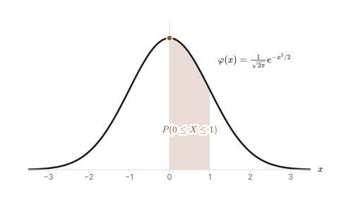
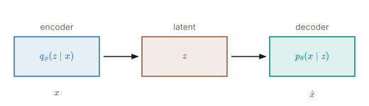
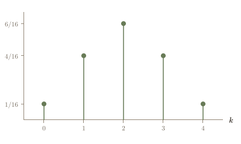

# Vellum

Vellum is a small library for drawing mathematical and technical figures as SVG with React. A figure is a plain definition: an id, a description, the sizes it can be drawn at, and a `render` function built from panels, marks, and labels. Vellum turns that definition into SVG text you can commit, embed in a web page, or convert to other formats with your own tools.

It is written to be used by people and by coding agents. The core knows nothing about where a figure ends up: it has no site layouts, page sizes, or print presets. Each project that uses Vellum decides those things and writes them down for itself.

| | | |
|---|---|---|
|  |  |  |

## A first figure

A definition lives in a file named after its id, `<id>.figure.tsx`:

```tsx
import React from "react";
import { defineFigure, Figure, Panel, Axes, Curve, MathLabel } from "@rio-agents/vellum";

export default defineFigure({
  id: "sine",
  description: "One period of the sine function.",
  layouts: { main: { width: 480, height: 240 } },
  render: () => (
    <Figure>
      <Panel area={{ x: 40, y: 20, width: 400, height: 190 }} x={[0, 2 * Math.PI]} y={[-1.2, 1.2]}>
        <Axes showTickLabels ticksY={[-1, 1]} xLabel="x" />
        <Curve fn={Math.sin} tone="accent" weight="bold" />
        <MathLabel tex={String.raw`\sin x`} at={[Math.PI / 2, 1]} anchor="s" offset={[0, -8]} tone="accent" />
      </Panel>
    </Figure>
  ),
});
```

`Panel` sets up data coordinates over a pixel rectangle. Inside it, `Curve` samples the function, `Axes` draws the axes, and `MathLabel` typesets TeX into SVG paths, so the output needs no fonts for its mathematics.

## Rendering

In a project, add a `vellum.config.mjs` at the root:

```js
/** @type {import("@rio-agents/vellum/build").VellumConfig} */
export default {
  sources: "figures",      // searched for <id>.figure.tsx
  output: "figures/svg",   // SVG files and manifest.json
};
```

Then run `vellum render` to render every figure, or `vellum render sine` for one. Each figure's primary layout (the first it declares) is written to `<id>.svg`, and any other layout to `<id>.<layout>.svg`.

To render in code instead, call `renderToSvgString(definition, { layout, theme, params })` from `@rio-agents/vellum/render/server`.

## Documentation

- [Concepts](docs/concepts.md): definitions, layouts, parameters, variants, and determinism.
- [Marks and coordinates](docs/marks.md): `Figure`, `Panel`, the coordinate rule, every mark, and text and math.
- [Themes](docs/themes.md): tones, text roles, and writing a theme.
- [Interactivity](docs/interactivity.md): parameters with controls, and mounting a figure in a page.
- [Animation](docs/animation.md): one timeline, playback, interpolation, stages, and explicit geometry transforms.
- [Rendering](docs/rendering.md): `vellum render`, its configuration and manifest, and rendering in code.
- [Extending](docs/extending.md): custom marks, raw SVG, themes, and post-processing the output.
- [Examples](examples/): working figure definitions and their rendered SVGs.

Agents should start with [AGENTS.md](AGENTS.md).

## Requirements

Node 22 or later and React 19. Vellum ships TypeScript source. Bundlers such as Vite and esbuild compile it directly. The `vellum` command runs the source through Node's type stripping.

Vellum is before 1.0. Breaking changes bump the minor version and are listed in the [changelog](CHANGELOG.md).

## License

MIT. See [LICENSE](LICENSE).
